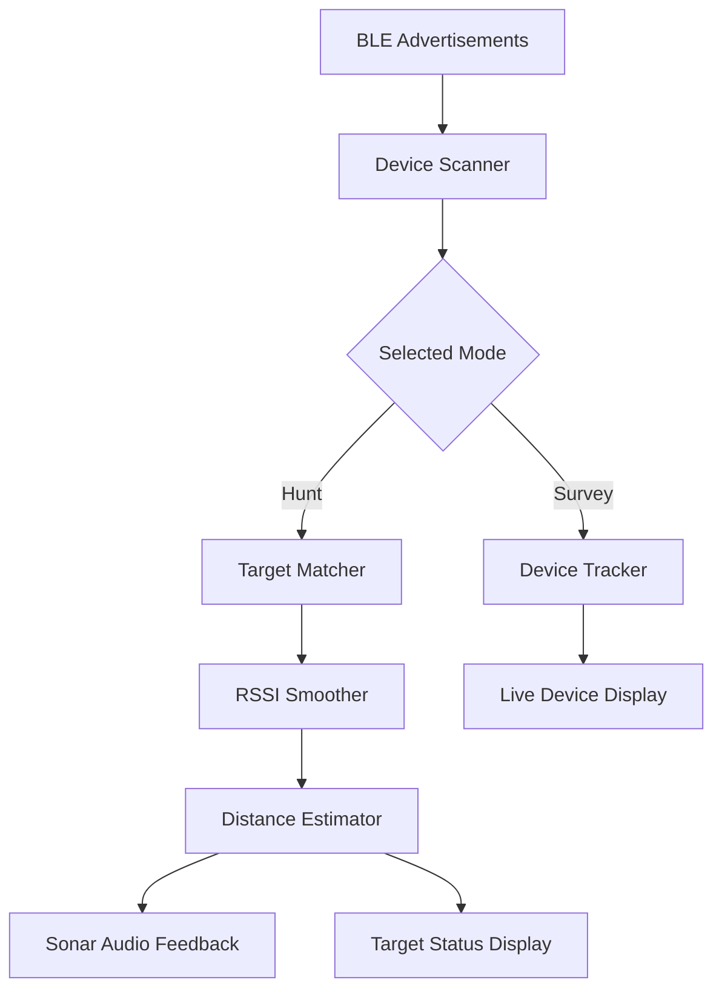

# Bluetooth Proximity Finder

A Python-based Bluetooth Low Energy (BLE) proximity detection tool that scans nearby devices, tracks a selected target, smooths signal strength readings, estimates approximate distance, and provides sonar-style audio feedback.

Built as a hands-on engineering project to explore BLE scanning, asynchronous programming, signal processing, and real-time device tracking.

## Features

- **Live Device Discovery:** Scan for nearby Bluetooth Low Energy devices.
- **Survey Mode:** View detected devices, Bluetooth addresses, and RSSI readings.
- **Hunt Mode:** Search for a specific device by its advertised name or Bluetooth address.
- **RSSI Smoothing:** Reduce signal fluctuations using a rolling average and duplicate-reading debounce.
- **Distance Estimation:** Estimate approximate distance using a log-distance path-loss model.
- **Sonar Audio Feedback:** Play periodic audio pings whose frequency of repetition changes with estimated distance.
- **Target Status Tracking:** Detect when a target is found or becomes temporarily unavailable.
- **Interactive Mode Switching:** Switch between Survey and Hunt modes without restarting the application.
- **Automated Tests:** Test device matching, RSSI smoothing, distance estimation, and audio timing logic.

## How It Works

The application processes Bluetooth advertisements and uses received signal strength (RSSI) to track nearby devices.



## Tech Stack

- **Language:** Python
- **Bluetooth:** Bleak
- **Asynchronous Programming:** asyncio
- **Signal Processing:** Rolling-average RSSI smoothing
- **Distance Estimation:** Log-distance path-loss model
- **Audio:** Windows `winsound` API
- **Testing:** pytest

## Project Structure

```text
bluetooth-proximity-finder/
├── main.py
├── requirements.txt
├── README.md
├── proximity_finder/
│   ├── __init__.py
│   ├── models.py
│   ├── scanner.py
│   ├── tracker.py
│   ├── target.py
│   ├── signal.py
│   ├── proximity.py
│   └── audio.py
└── tests/
    ├── test_tracker.py
    ├── test_target.py
    ├── test_signal.py
    ├── test_proximity.py
    └── test_audio.py
```

## Getting Started

### Prerequisites

- Windows 10 or Windows 11
- Python 3.10 or newer
- Bluetooth adapter with BLE support
- Bluetooth enabled on your computer
- A nearby BLE device that advertises detectable packets

### 1. Clone the repository

```powershell
git clone https://github.com/0xashishtiwari/bluetooth-proximity-finder.git
cd bluetooth-proximity-finder
```

### 2. Create a virtual environment

```powershell
python -m venv .venv
```

Activate it:

```powershell
.\.venv\Scripts\Activate.ps1
```

### 3. Install dependencies

```powershell
python -m pip install -r requirements.txt
```

### 4. Run the application

```powershell
python main.py
```

## Usage

When the application starts, select a mode from the interactive menu.

### Survey Mode

Survey Mode continuously displays nearby BLE devices, including their names when available, Bluetooth addresses, raw RSSI, and smoothed RSSI.

Use this mode to discover devices and identify the target you want to track.

### Hunt Mode

Select Hunt Mode and enter the target's advertised name or Bluetooth address.

Example:

```text
Enter target device name or Bluetooth address: 44:17:00:29:1E:62
```

The application reports the target's status:

- **SEARCHING:** The target has not yet been detected.
- **FOUND:** The target is being detected and its signal strength is tracked.
- **LOST:** No target advertisement has been received within the configured timeout.
- **NOT FOUND:** The target was not detected within the initial search window.

When the target is detected, the application displays RSSI readings and an estimated distance. Sonar-style audio feedback provides an additional proximity cue.

### Navigation Controls

| Key | Action |
|---|---|
| `1` | Start Survey Mode |
| `2` | Start Hunt Mode |
| `M` | Return to the main menu from an active mode |
| `0` | Exit the application |
| `Ctrl+C` | Interrupt the application |

## RSSI Smoothing

Bluetooth RSSI can fluctuate because of device orientation, walls, interference, reflections, and other environmental factors.

The application uses a rolling average with a window size of five readings. A debounce interval prevents identical readings arriving too close together from being counted repeatedly.

This helps reduce rapid changes in displayed signal strength, although it cannot eliminate wireless signal variability.

## Distance Estimation

The application uses a log-distance path-loss model:

\[
d = 10^{\frac{A-\mathrm{RSSI}}{10n}}
\]

Where:

- \(d\) is the estimated distance in meters.
- \(A\) is the calibrated RSSI reference at one meter.
- \(\mathrm{RSSI}\) is the smoothed signal strength in dBm.
- \(n\) is the path-loss exponent.

The current calibration parameters are:

| Parameter | Value |
|---|---:|
| Reference RSSI (\(A\)) | -52.3 dBm |
| Path-loss exponent (\(n\)) | 3.67 |
| RSSI smoothing window | 5 readings |
| Duplicate-reading debounce | 0.2 seconds |

These parameters were fitted using a small set of measurements from the developer's Bluetooth device.

**Important:** Distance estimates are approximate and depend on the device, environment, orientation, and interference. The current calibration is specific to the tested setup and should not be assumed accurate for other devices or locations.

## Running Tests

Run the test suite from the project root:

```powershell
python -m pytest -v
```

The tests cover core logic such as:

- Device matching
- Device tracking and stale-device cleanup
- RSSI smoothing and debounce behavior
- Distance estimation
- Sonar beep interval calculations

The audio timing tests validate the interval logic; they do not independently verify physical audio playback.

## Limitations

- The application focuses on Bluetooth Low Energy advertisements, not every Bluetooth device or connection type.
- Some devices do not include a readable name in their advertisements.
- A device may be visible in Windows settings but not expose its name during BLE scanning.
- RSSI is not a reliable standalone measurement of physical distance.
- Audio feedback currently uses Windows-native sound generation.
- Bluetooth adapter availability and permissions may affect scanning behavior.

## Future Improvements

- Improve scanner recovery and Bluetooth adapter error handling.
- Add configurable distance thresholds and audio settings.
- Improve calibration using repeated measurements at known distances.
- Add signal-strength history and live RSSI visualization.
- Improve cross-platform audio support.
- Package the application for easier installation.

## Learning Outcomes

This project explores practical concepts in:

- Event-driven and asynchronous Python
- Bluetooth Low Energy scanning
- State management and device tracking
- Rolling-window signal smoothing
- Mathematical modeling and calibration
- Audio feedback and real-time interaction
- Unit testing and modular application design

## License

Add a license before distributing or accepting contributions. Until a license is added, the repository's reuse permissions are not explicitly granted.

---

**Author:** [Ashish Kumar Tiwari](https://github.com/0xashishtiwari)

**Repository:** [bluetooth-proximity-finder](https://github.com/0xashishtiwari/bluetooth-proximity-finder)
